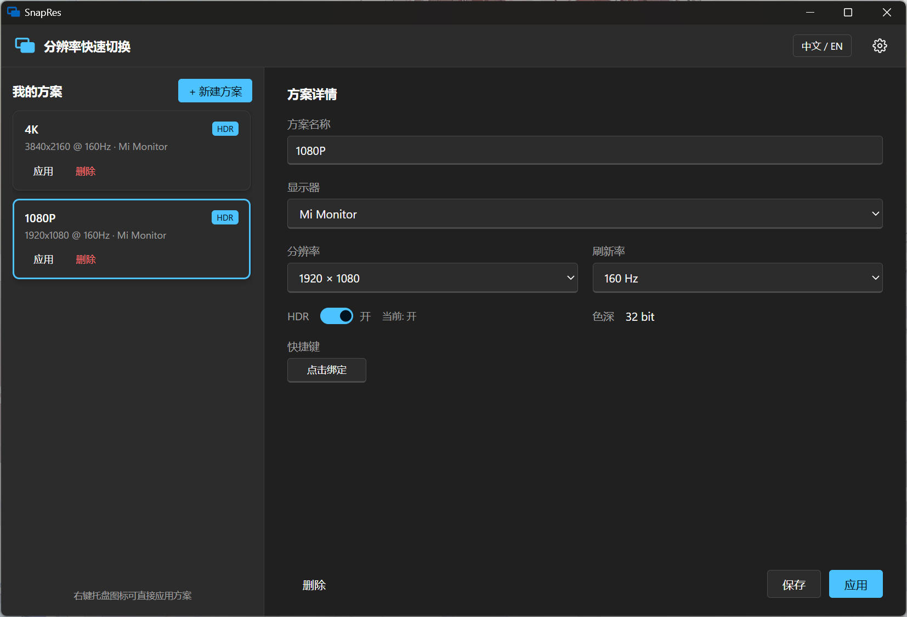

# SnapRes

> 面向 Windows 的桌面常驻小工具：把「显示器 + 分辨率 + 刷新率 + HDR」保存成命名方案，之后用一次点击、托盘菜单或全局快捷键在两套显示配置之间瞬间切换，不必再进「设置 → 系统 → 显示」逐项调整。



## 功能特性

### 显示器能力枚举与实时状态

- 通过 Win32 显示配置接口枚举当前所有活动显示器（含友好名称，如具体型号）。
- 每台显示器可列出其全部支持的分辨率与对应刷新率，并读取当前分辨率、刷新率、色深和 HDR 状态。
- 分辨率下拉中会标注「当前」项；HDR 区分「不支持 / 开 / 关」，并额外显示系统实际处于哪种状态。

### 方案（Profile）管理

- 新建方案：填名称，选显示器、分辨率、刷新率、HDR，可选绑定快捷键。
- 方案以卡片形式排在左侧，卡片显示「宽×高 @ 刷新率 · 显示器名」，HDR 开启时带角标。
- 右侧详情页可改名、改参数、改快捷键；有未保存修改时显示 `● 有未保存的修改`，此时才出现「取消」按钮，保存后按钮自动消失。
- 删除有二次确认；方案数据持久化在本地，重启后仍在。

### 三种触发方式，同一套执行逻辑

| 方式       | 说明                                                            |
| ---------- | --------------------------------------------------------------- |
| 界面按钮   | 方案卡片上的「应用」或详情页的「应用」                          |
| 托盘菜单   | 右键托盘图标，菜单里直接列出所有方案，点一下即切换              |
| 全局快捷键 | 每个方案可绑定一个组合键（如 `Ctrl+Alt+1`），程序在后台也能触发 |

切换时写入分辨率/刷新率并同步注册表（重启后仍生效），随后按方案设置 HDR；执行完会回吐结果（成功描述或失败原因），并在界面里 toast 提示、刷新显示器状态。

### 循环切换

- 单独一个「循环切换快捷键」（默认 `Ctrl+Alt+R`），每按一次按顺序切到下一个方案，由 Rust 侧直接执行，不依赖窗口是否可见。
- 循环快捷键与方案快捷键注册时会去重，避免同一组合被占用两次。

### 快捷键录制

- 点击快捷键按钮进入录制态，按下的键位实时回显（`Ctrl` → `Ctrl + Alt` → `Ctrl + Alt + R`），松开修饰键回显同步收缩，`Esc` 取消。
- 强制要求包含 Ctrl / Alt / Shift / Win 之一；应用内冲突会提示「该快捷键已被占用」；注册失败（被其他程序占用）会提示。

### 托盘常驻与关闭行为

- 左键托盘图标显示/聚焦主窗口，右键菜单可显示窗口、应用某个方案、退出程序。
- 关闭窗口时弹中间弹窗，二选一：直接关闭程序，或隐藏到托盘继续后台运行；可勾选「记住我的选择，不再询问」。
- 该询问可在设置里重新开启或关闭；关闭询问后，行为固定为「隐藏到托盘」或「直接退出」二者之一。

### 设置面板

- 顶栏语言按钮右侧的齿轮进入，占用右侧主区域，分四组：
  - 外观：深色/浅色主题切换；
  - 启动：开机自启（写当前用户启动项），开关后状态行实时反馈成功/失败原因；
  - 快捷键：循环切换快捷键的录制与清除；
  - 窗口行为：关闭时是否询问、不询问时的默认动作。

### 交互与外观

- 中英文一键切换，全部界面文案双语；语言、主题、方案、关闭策略都持久化。
- Fluent 风格界面，浅色/深色两套配色；操作结果统一用底部 toast 反馈。
- 显示器热插拔后重新枚举；方案引用的显示器断开时提示「所选显示器已断开」。

## 典型使用流程

1. 安装后常驻托盘，首次启动自动读取当前显示器与可用模式。
2. 新建「游戏 2K 165Hz」「办公 4K 60Hz」「投影 1080p」等方案，各绑一个快捷键。
3. 日常用快捷键或托盘菜单切换；关闭窗口时选择隐藏到托盘，程序继续待命。
4. 需要改配置时点齿轮进设置，调主题、开机自启、循环键或关闭策略。

## 技术实现

- **前端**：Vue 3 `<script setup>` + Vite，单文件组件，无 UI 框架依赖。
- **后端**：Rust + Tauri 2，直接调用 `windows` crate 的 Win32 API（`QueryDisplayConfig`、`EnumDisplaySettingsW`、`ChangeDisplaySettingsExW`、`DisplayConfigSetDeviceInfo`），无第三方驱动。
- **插件**：`tauri-plugin-global-shortcut`（全局热键）、`tauri-plugin-autostart`（开机自启）、`tauri-plugin-opener`。
- **数据流**：前端把方案列表和循环快捷键同步给 Rust（`sync_plans`），Rust 负责注册全局热键并重建托盘菜单；热键/托盘触发后由 Rust 直接切换，再通过事件把结果推回前端。
- **安装包**：NSIS，per-machine 安装到 `Program Files`，安装器启动即请求 UAC；仅支持 Windows（依赖 WebView2）。

## 下载与安装

前往 [Releases](https://github.com/LFT135/SnapRes/releases) 下载 `SnapRes_0.1.0_x64-setup.exe`，双击安装（会请求管理员权限），安装完成后从开始菜单或托盘启动。

系统要求：

- Windows 10 / 11（x64）
- WebView2 Runtime（安装器会在缺失时自动下载安装）

## 本地构建

需要 Node.js 18+、Rust 工具链（stable）、Visual Studio Build Tools（C++ 桌面开发）。

```bash
npm install
npm run tauri dev     # 开发调试
npm run tauri build   # 构建，产物在 src-tauri/target/release/bundle/nsis/
```

## 已知限制

- 仅 Windows；非 Windows 平台只有占位实现。
- 只改分辨率、刷新率、HDR，不改缩放/DPI、显示器排列方式（扩展/复制）、色彩配置文件、色温等。
- 色深只读展示，不可选择；HDR 切换为尽力而为，失败只记录日志、不影响分辨率切换。
- 无按程序/游戏自动切换、无配置云同步或导入导出；方案存于本机当前用户。
- 全局快捷键被其他程序占用时只能报告失败，无法抢占。
